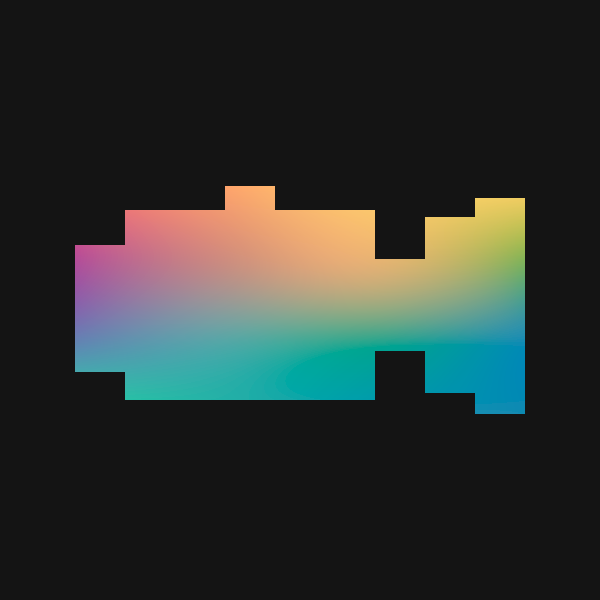
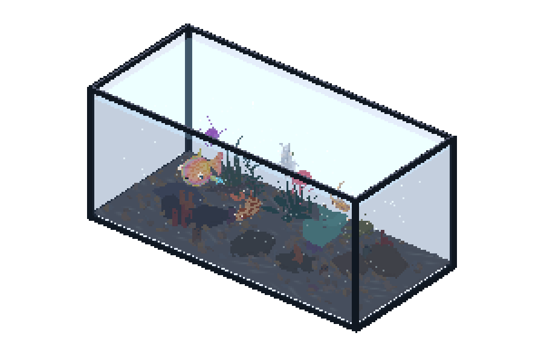

<p align="center">
  
  &nbsp;&nbsp;
  
</p>

<p align="center">
  <strong>A small underwater environment</strong><br />
  Procedural marine life generation.
</p>

**Abisso** is an interactive experience for creating, watching, and customizing digital aquariums. A word, an image, or a random discovery becomes an aquarium filled with different creatures, each with its own textures, shapes, and behaviors.

From fish to other creatures, every aquarium brings together inhabitants, plants, and decorations in a scene you can explore, reshape, and share.

<p align="center">
  
  <br />
  <sub>Aquarium generated with the seed <code>recife</code></sub>
</p>

[Explore Abisso online ↗](https://gajonormal.github.io/ABISSO/)

## One starting point, a whole aquarium

| Starting point | What happens                                                                                                                 |
| -------------- | ---------------------------------------------------------------------------------------------------------------------------- |
| **Text**       | Words guide a shared color palette and, when recognized by local rules, the environment. Try `forest`, `abyss`, or `sunset`. |
| **Image**      | Dominant colors are distributed across all creatures and guide the water, habitat, decorations, and vegetation.              |
| **Random**     | A random seed creates a new combination of inhabitants and scenery.                                                          |

Generation is **procedural and local, without generative AI**. Text uses seeds and keyword rules; images provide colors and a visual signature, without object recognition. The same input produces the same initial aquarium. Images used for generation stay on your device.

## Discover, observe, and customize

- **22 available species**, with variations in anatomy, patterns, fins, eyes, finishes, and mutations.
- **Three environments** - tropical reef, abyss, and gardens on classic, panoramic, or vertical tanks.
- **Populated aquariums**, with the number of inhabitants adjusted to the chosen tank's capacity.
- **Life in motion:** creatures with individual behaviors, feeding, growth, animated plants, and drifting particles.
- **Creature and aquarium customization**, organized into **Creature**, **Aquarium**, **Create**, and **Save & Share**.
- **3D exploration:** drag to rotate, scroll to zoom, and click a creature to edit it.
- **Save and share:** export PNG images, save or import JSON data, keep a local collection, and share an aquarium through a link.

## Export an aquarium widget

Open **Customize → Save & Share → Export widget** to save an aquarium as a standalone HTML file. Choose **Keep this aquarium** to preserve its creatures and environment, or **Random on every load** for a different aquarium each time it opens. The background can be transparent. **Allow rotation** and **Allow zoom** are independent options: enable both, either one, or neither. A live preview shows the result.

The downloaded `abisso-widget.html` includes the aquarium data, rendering engine, and Three.js license. It needs no connection to Abisso, external libraries, or backend after download. It runs in a modern browser with JavaScript and WebGL support.

Upload the file to your own website and paste the embed code provided by the exporter. For example:

```html
<iframe
  src="abisso-widget.html"
  title="Abisso aquarium"
  loading="lazy"
  sandbox="allow-scripts"
  style="display:block;width:100%;height:420px;border:0;background:transparent"
></iframe>
```

Adjust the file path and height for your page. The host site must allow [iframe embeds](https://developer.mozilla.org/en-US/docs/Web/HTML/Reference/Elements/iframe) and the widget's scripts; platforms that strip custom HTML cannot display it. The widget contains no editor menus or collection storage and suspends rendering while hidden or outside the viewport.

## Run locally

**Node.js 22 or later** needed and a browser with WebGL support. There is no build step; Three.js is already included in the repository.

```sh
git clone https://github.com/gajonormal/ABISSO.git
cd ABISSO
npm start
```

Open [localhost:4200](http://127.0.0.1:4200/).

To choose a different port in PowerShell:

```powershell
$env:PORT = '4201'
npm start
```

## How it is built

Abisso uses **JavaScript, HTML, and CSS**, with **Three.js** for 3D rendering and shaders. The engine generates creature anatomy, environments, and movement from seeds.

The site does not need a backend to generate aquariums. Collections are stored in the browser's `localStorage`; JSON files let you move them between devices, and sharing links include the aquarium state in the URL.

| Location                                  | Responsibility                                                |
| ----------------------------------------- | ------------------------------------------------------------- |
| `index.html`, `abisso.js`, `abisso.css`   | Landing page and aquarium generation entry points.            |
| `environment.js`, `landing-boot.js`       | Underwater scenery and experience loading.                    |
| `engine/`                                 | Editor, genetics, anatomy, movement, habitats, and rendering. |
| `engine/inspiration.js`                   | Image color palettes and text inspiration rules.              |
| `cursor.js`, `cursor.css`, `controls.css` | Animated cursor and shared controls.                          |
| `assets/`                                 | Visual identity, aquarium preview, and contribution map.      |
| `scripts/`                                | Project checks and asset generation.                          |
| `server.mjs`                              | Static server for local development.                          |

## Publishing

The public site is hosted at **[gajonormal.github.io/ABISSO](https://gajonormal.github.io/ABISSO/)** using GitHub Pages. Visitors can access the website without a GitHub account.

Pushing to `main` automatically runs the [deployment workflow](.github/workflows/deploy-pages.yml). Successful contribution-map updates also trigger a fresh deployment. Publication can be started manually from **Actions → Deploy site to GitHub Pages → Run workflow**.

```sh
npm run build
```

This prepares `dist/` with only the public HTML, CSS, JavaScript, engine, and assets. Tests, development tools, repository metadata, and the local server are excluded. The generated folder is ignored by Git and can also be hosted by another static hosting provider.

## Development

Development tools are optional for running the site. To install them:

```sh
npm ci
```

| Command                | Purpose                                                                |
| ---------------------- | ---------------------------------------------------------------------- |
| `npm start`            | Start the local server.                                                |
| `npm run check`        | Check syntax, local references, HTML IDs, formatting, and unused code. |
| `npm run check:unused` | Analyze production files, exports, and references with Knip.           |
| `npm run format:check` | Check the style defined in the Prettier configuration.                 |
| `npm run format`       | Apply the configured formatting.                                       |

## Contributing

Ideas for new creatures, environments, and interactions are welcome. When reporting an issue, include the steps to reproduce it, your browser, and, if possible, the seed or aquarium link. For code changes, describe the expected behavior and the checks you performed.

<details>
<summary><strong>Seeds, inspiration, and compatibility</strong></summary>

Text rules recognize Portuguese and English keywords in these groups: abyss/night, forest/garden, reef, ice/blue, sun/fire, and purple/pink. When multiple groups match, their palettes are combined; the first group in this order determines the environment. Other text generates a repeatable palette from its seed.

Image generation extracts up to six dominant colors and distributes them across the inhabitants' primary and accent colors. The palette also guides the environment. This process does not recreate the composition or identify the contents of a photograph.

Existing JSON formats and the local storage key `mare.collection.v1` are preserved. Older editor mode links are redirected to the current aquarium view.

</details>

---

Created by [**Bernardo Maia**](https://github.com/gajonormal). Rendered with [Three.js](https://threejs.org/), included under its [MIT license](engine/vendor/THREE-LICENSE.txt).
